# Vision

Vision gives every request for help one named holder, from the first message to the moment the resident says it is done.

Team KanyaRaasi: Shritej Gunda, Yuktha and Venkata.

Hacksgiving 2026: AI for Good, with ComForce MKE, the MSOE AI Club and MSOE. Milwaukee, November 19 to 22, 2026.

Vision is a working system for ComForce MKE in Milwaukee. A resident asks for help on the web, by email or by voicemail. From that moment, one named person holds the request: the desk, a volunteer or a partner. The request goes hand to hand with a receipt at each step, and every hold has a clock. A job counts as helped only when the resident says yes.

One holder, hand to hand, never dropped. All data in this repository is synthetic.

To run the whole demo on one laptop, follow [section 9](#9-run-it-on-a-laptop).

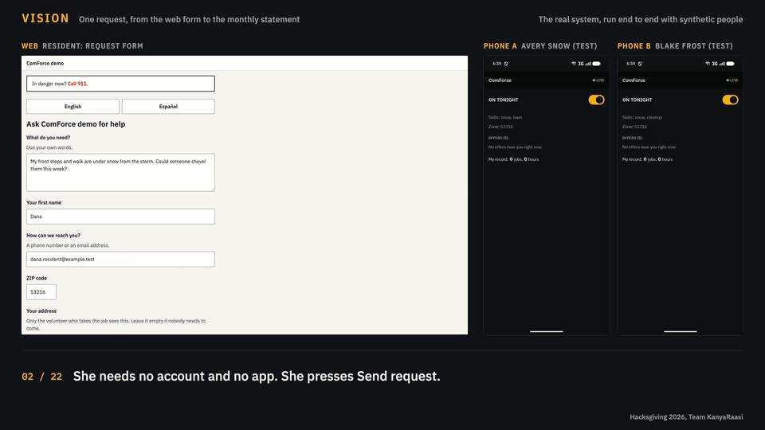

*The demo thread on synthetic data, recorded on a laptop hub with two Android emulators and live AI. A resident asks for help, the AI sorter suggests the need and the urgency, the desk confirms the card, two phones get the offer, the first ACCEPT wins and the resident follows each step on the tracking page.*

The full video with captions is [docs/media/thread.mp4](docs/media/thread.mp4).

## Media

| | |
|---|---|
| 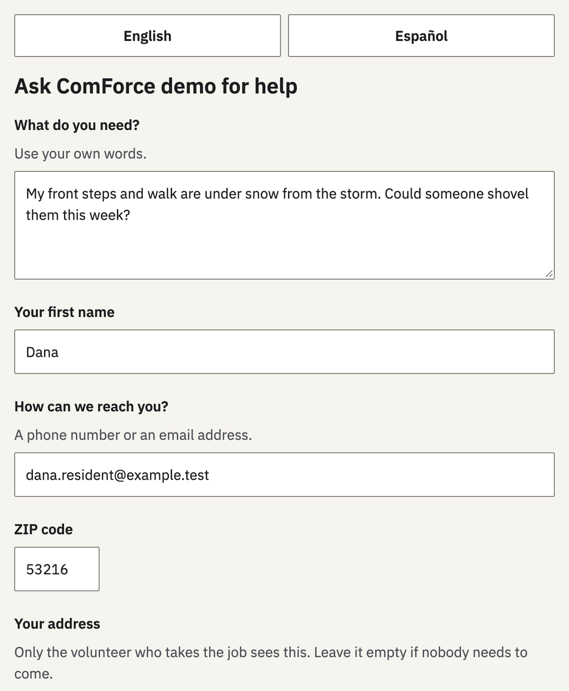 | 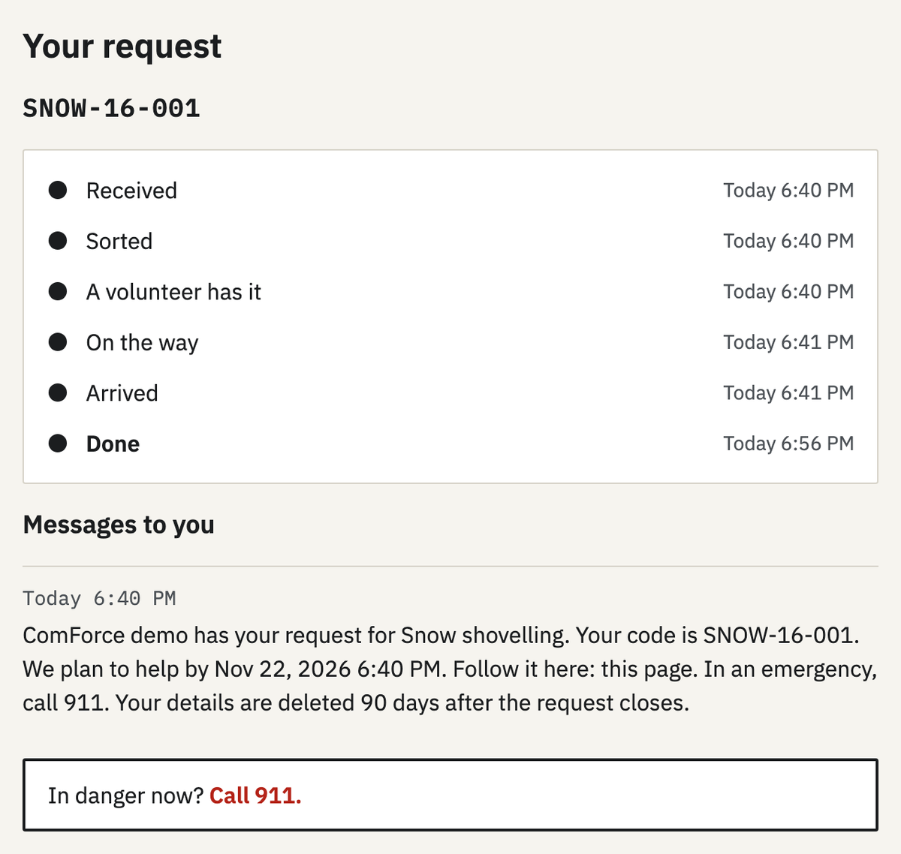 |
| The request form. The resident needs no account and no app. | The tracking page shows each step and its time. |
| 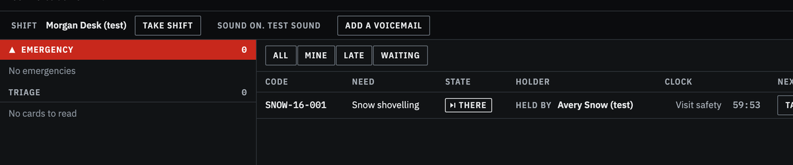 | 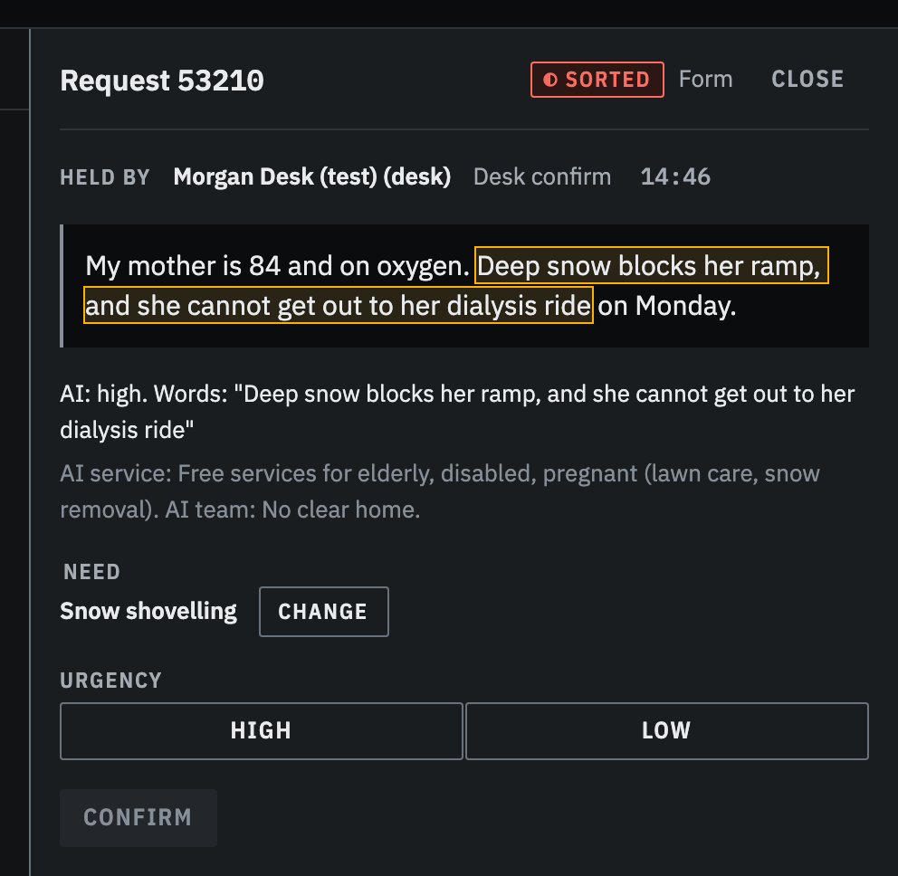 |
| The desk board: lanes, codes, holders and clocks. | A card on the desk. The AI sorter suggests the need and the urgency and marks the words it used. A person picks the urgency and confirms. |
| 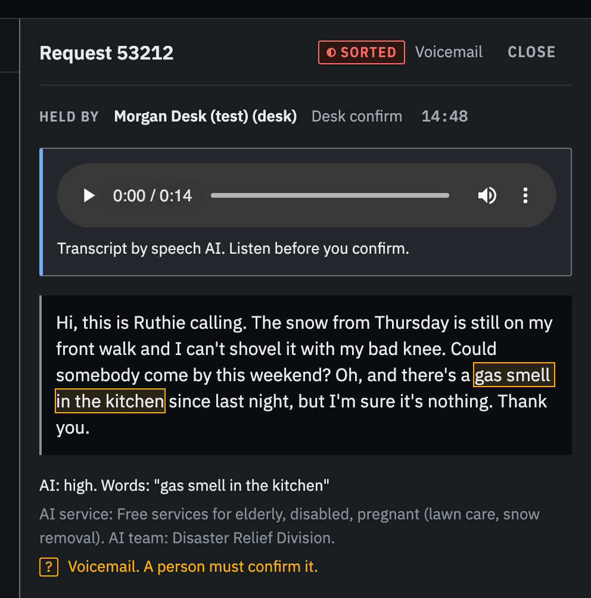 | 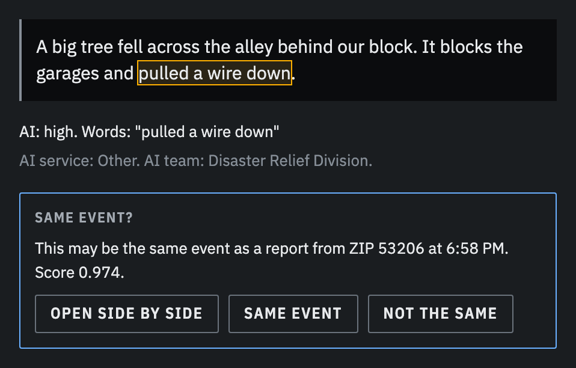 |
| A voicemail card. The recording sits above the transcript by speech AI, and the card tells the desk to listen before it confirms. | "Same event?": two reports of one fallen tree in one ZIP code scored 0.974. A person answers, and a link never merges a card. |
| 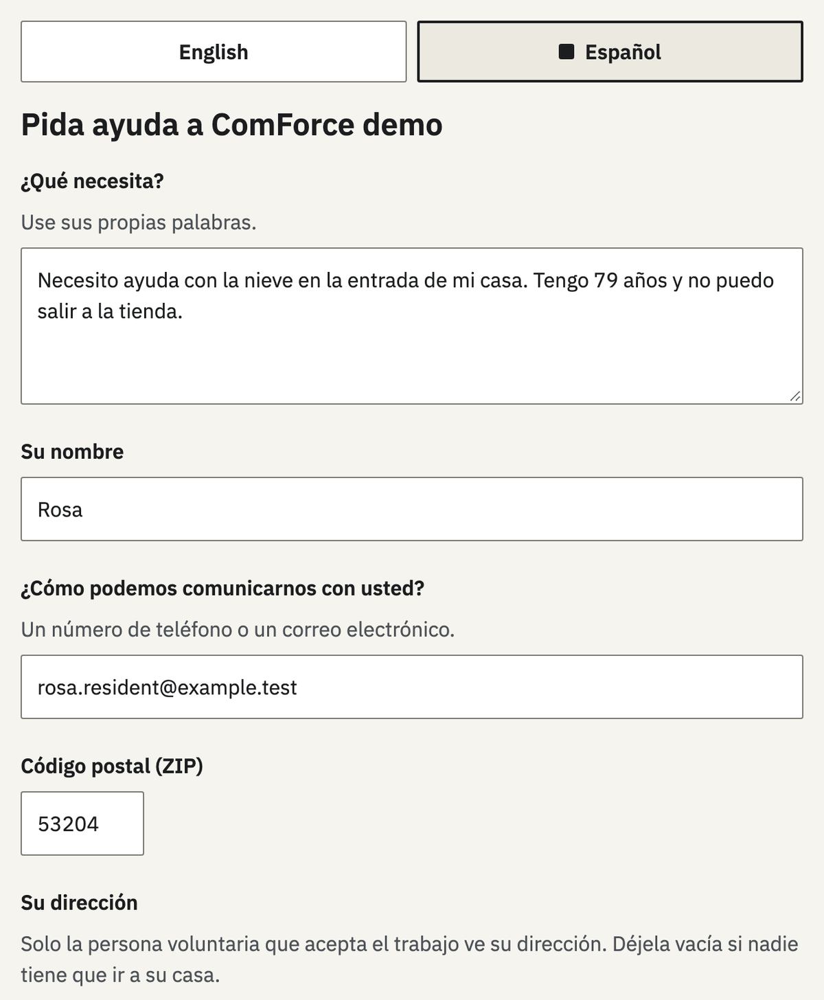 | |
| The request form in Spanish. People wrote every Spanish word that a resident sees. | |
| 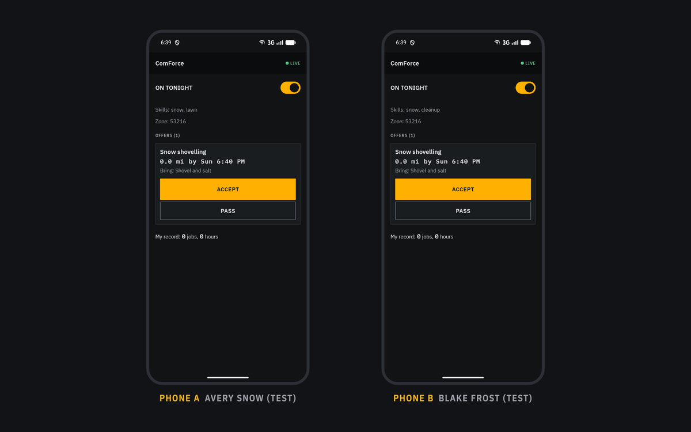 | 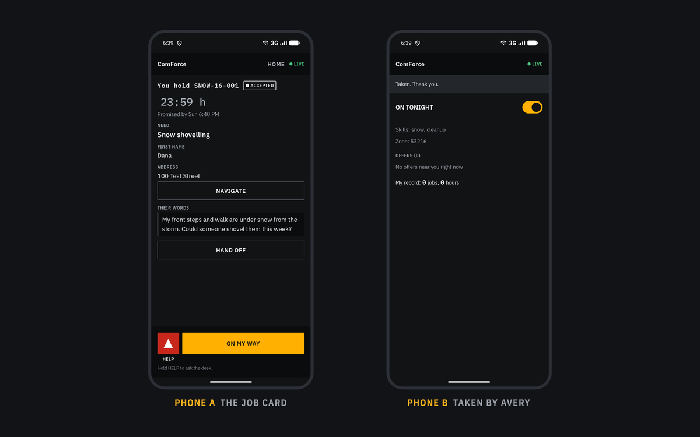 |
| Two volunteer phones get the same offer, with no name and no address. | The first ACCEPT wins. Only the holder sees the address, and the other phone shows "Taken. Thank you." |
| 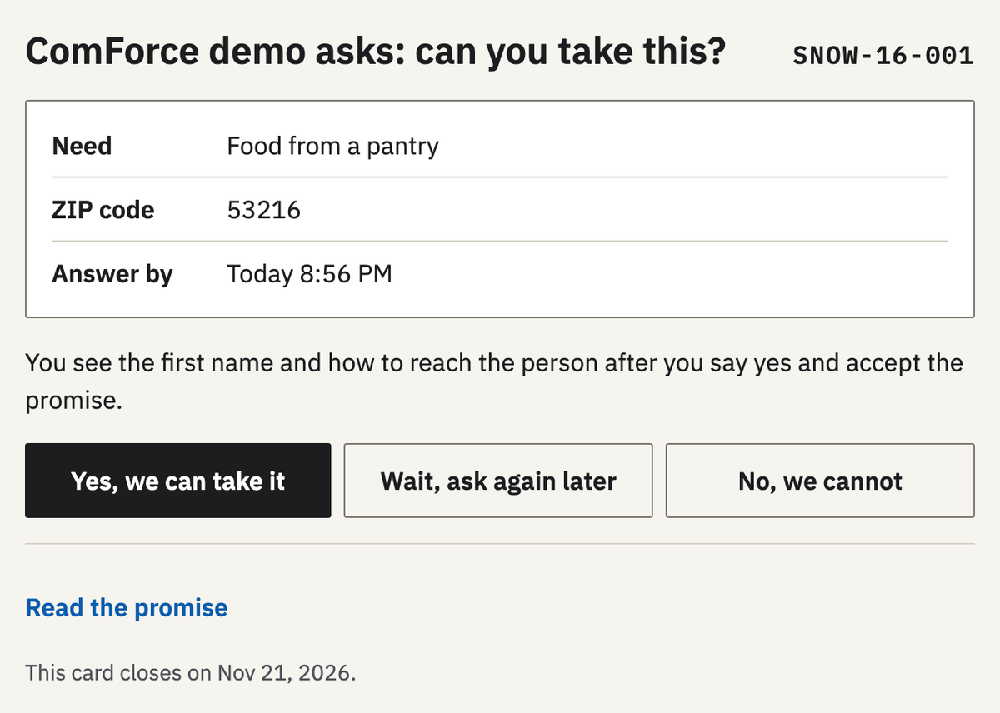 | 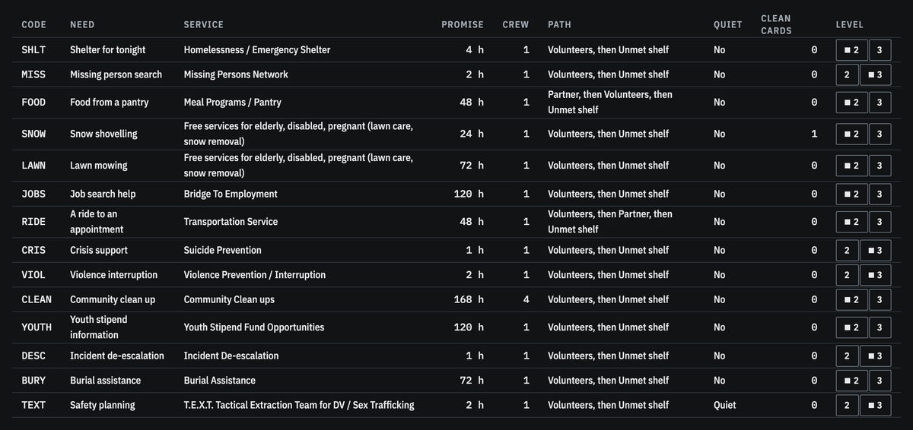 |
| The partner card, opened by a link with no account. | The playbook of the organiser: the owner, the path and the promise time for each need. |
| 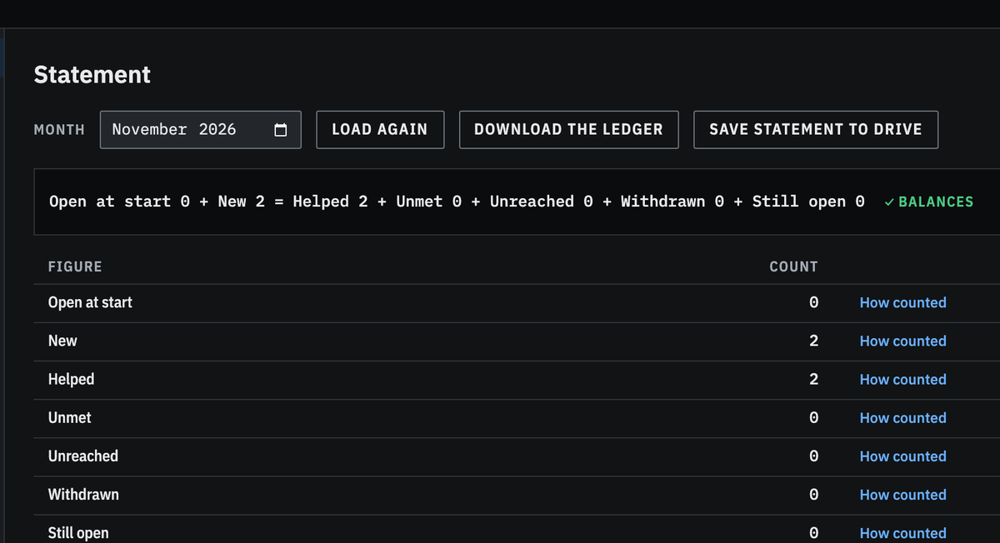 | 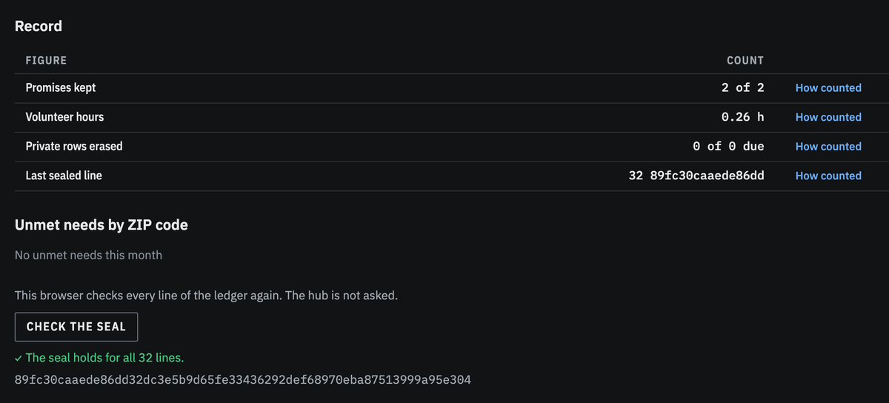 |
| The monthly statement balances: 2 new requests, 2 helped. | The record and the seal check. The browser checks the seal over all 30 ledger lines. |

Every picture and the video come from one laptop run with live AI on 2026-11-21, using `make media`.

## 1. The problem

Requests for help in Milwaukee are easy to take and easy to drop. The challenge brief of the event says that requests and referrals "can be difficult to coordinate and track". It also says that groups struggle to "demonstrate their impact to funders and community partners".

A shared list alone does not finish the work:

- **Logged is not helped.** After the August 2025 flood, Milwaukee reports went into Crisis Cleanup, a national disaster database. More than 7,000 cases were logged, and in March 2026 more than 5,000 were still open (NNS, March 4, 2026).
- **Unfinished work moves to someone else.** NNS reports that Flood Hope 500 had to complete unfinished work by the city or other organizations (NNS, May 13, 2026).
- **A survey is not a count.** The IMPACT 211 summary for 2025 reports that 97 percent of needs were resolved. The same report lists 145 of 145 air-conditioner requests as unmet.
- **Not every resident is online.** In ZIP code 53206, 14.8 percent of households have no internet (American Community Survey 2020 to 2024). A web form alone leaves these residents out.

## 2. The key insight

A better front door is easy to build. Requests are dropped between hands.

We followed one request through the 8 steps of the work at ComForce today: intake, sorting, the path, volunteers, the hand-over to a partner, follow-up, the record and the report. The difficulties that the brief names all come after intake. The hand-offs are where a request goes quiet, because nobody holds it.

Other fields closed this gap with three rules:

- **One named owner.** A volunteer or a partner takes a job with a receipt, and from then on that person holds it.
- **A clock that escalates.** In Dar es Salaam, 87 community health workers got reminders that went to a supervisor when a visit was late. In the first study, the average days overdue fell by 86 percent, from 9.7 to 1.4. When the step to the supervisor was removed in the second study, performance fell (DeRenzi et al., 2012). The open-source HOT Tasking Manager also releases a claimed task by itself after 2 hours by default.
- **A second key.** The person who was helped closes the case. The referral platform findhelp lets the person mark "Got Help" or "Couldn't Get Help" (SIREN guide, 2026).

A fourth finding shaped the offer. In London, a GoodSAM responder accepted an alert on 56 of 354 occasions, about 16 percent. If 10 people are asked at once and each answers on their own, the chance of at least one yes is about 83 percent (1 minus 0.84 to the power of 10). So Vision asks a wave of up to 10 volunteers at once, and exactly one ACCEPT wins.

Vision puts these rules into one system. Each rule is written in `CONSTITUTION.md` and tested in code.

## 3. How Vision works

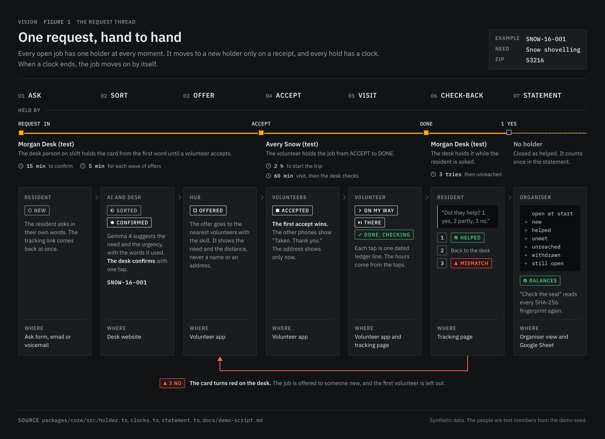

*One request, hand to hand: a synthetic snow request goes from the ask form to HELPED, with one named holder at every step, a receipt at every hand-off and a clock on every hold.*

1. **A request comes in.** A resident uses the web form, an email or a voicemail. The resident gets a route code, for example `SNOW-16-001`, and a tracking link at once.
2. **The desk confirms.** The AI sorter suggests the need, the team and the urgency, and it quotes the words it used. A person on the desk reads the card and confirms it. The desk has 15 minutes. After that, Vision pages the next person on the page list.
3. **The path is set.** The playbook row for the need gives the ladder: volunteers, one partner, then the unmet shelf. The desk approves the plan.
4. **Volunteers get a wave.** Up to 10 nearest volunteers with the right skill get the same offer at the same moment. The offer shows the need, the distance, the time and what to bring, and never a name or an address. If nobody accepts in 5 minutes, the next wave goes out.
5. **The first ACCEPT wins.** Exactly one volunteer gets the job, and the other phones show "Taken. Thank you." Only the holder now sees the name and the address. A volunteer who does not start in 2 hours loses the claim, and the job returns to the desk.
6. **The volunteer works the job.** The volunteer taps ON MY WAY, I AM THERE and DONE. Each tap shows on the tracking page of the resident with its time. A visit that runs over 60 minutes gives the desk a safety check.
7. **A partner can take a job.** A partner answers YES, NO or WAIT on a partner card, by a link with no account. The partner taps GOT IT as the receipt. The resident must agree before a partner sees the short note.
8. **The resident gives the second key.** After DONE or GOT IT, the check-back asks: "Did they help? 1 yes, 2 partly, 3 no." It goes after 24 hours for an urgent job and after 3 days for others. A yes closes the job as helped. A no returns it to the desk as a mismatch, and it goes to a new volunteer.
9. **Silence is not success.** The check-back tries 3 times, 24 hours apart. A job with no answer closes as unreached, and it is never counted as helped.
10. **The month balances.** The monthly statement accounts for every job, for example `Open at start 0 + New 3 = Helped 1 + Unmet 1 + Unreached 0 + Withdrawn 0 + Still open 1`. Every ledger line is sealed to the line before it.

The desk can tap every step for a volunteer with no Android phone. The desk can also offer a job to one named volunteer.

## 4. The connected systems

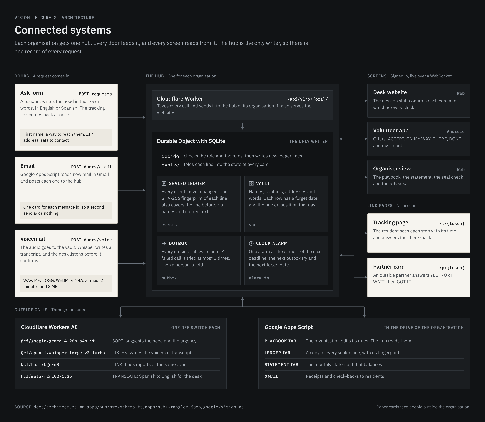

*Connected systems: three doors feed one Cloudflare hub for each organisation, and the hub serves the team screens and the link pages and calls Workers AI and Google Apps Script through its outbox.*

Every screen talks to one hub. The hub checks the rules, writes the ledger and sets the clocks. The screens send commands and show views. The hub is the only writer.

Vision has five screens and one optional record:

| Part | Who uses it | What it is |
|---|---|---|
| Resident pages | Residents, with no account | A request form in English or Spanish, and a tracking page by a link |
| Desk website | The desk person on shift | The emergency and triage lanes, cards with quoted words, the holders and their clocks |
| Volunteer app | Volunteers | An Android app: an on and off switch, offers, the job card and the record of each volunteer |
| Organiser view | Organisers and leads | The playbook, members, partners, the unmet shelf, the statement, the seal check, the rehearsal and the demo clock |
| Partner card | An outside partner, by a link with no account | One job with YES, NO, WAIT and GOT IT |
| Record | ComForce | An optional Google Sheet in the Drive of ComForce, written by one Apps Script |

Requests come in through three doors. A partner answers through a link page.

| Door or link | How it works |
|---|---|
| Web form | The form at `/ask`. It has a limit of 5 requests in 10 minutes for each network address, a hidden trap field and no picture puzzle. |
| Email | The optional Apps Script reads a Gmail label every 5 minutes and sends each mail to the mail door of the hub. |
| Voicemail | The desk adds a recording with "Add a voicemail". Speech AI writes a transcript, and the desk listens before it confirms. |
| Partner link | A partner answers one job by its link. The link opens one card only. |

The voicemail door keeps the audio above the transcript for a reason. Five speech systems made about twice the errors for Black speakers, with a word error rate of 0.35 against 0.19 (Koenecke et al., 2020). Whisper invented phrases in about 1 percent of transcripts (Koenecke et al., 2024). So a transcript never takes the place of the audio.

Vision is built on how ComForce works today. The call-out to many volunteers becomes a wave with one holder. Partners need no login. The desk taps for volunteers with no phone for the app.

## 5. AI: four jobs, one rule set

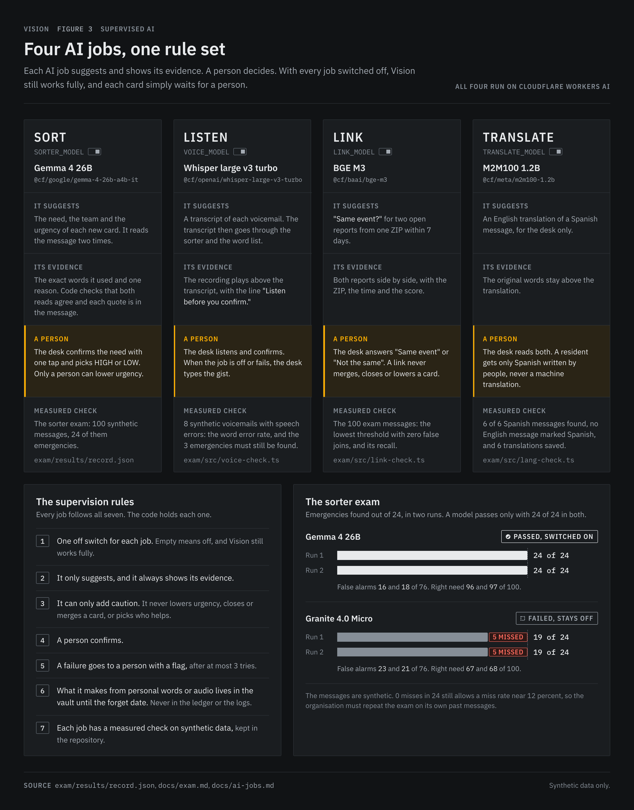

*Four AI jobs. Each one suggests and shows its evidence, and a person confirms.*

Vision uses four AI jobs. The sorter suggests the need and the urgency with Gemma 4 26B. Whisper large v3 turbo writes a transcript of each voicemail. BGE M3 finds two open reports of the same event in one ZIP code within 7 days. M2M100 1.2B translates a Spanish message for the desk.

All four use open-weights models on Cloudflare Workers AI, inside the free daily allowance for a demo, with no separate model licence or API key. No job decides anything about a person. Every job follows the same seven supervision rules in `docs/ai-jobs.md`: one off switch, evidence on screen, caution only, a person confirms, a flag after at most 3 failed tries, nothing personal in the ledger or the logs, and a measured check on synthetic data.

The AI never writes its own words to a resident. Messages to residents come only from fixed templates that people wrote, in English and in Spanish.

The sorter is on for the finals with Gemma 4 26B (D27 in `docs/decisions.md`). The three other jobs stay on (D31). The same-event job proposes a link at a score of 0.75 or more, and the desk decides each one. The translation job shows a stronger warning on the desk card: "Machine translation from Spanish. It can miss or change words, so check the original above before you decide."

### The sorter exam

No sorter model is switched on before it passes an exam. The exam has 100 synthetic messages, and 24 of them are emergencies. A model passes only when it finds all 24 emergencies in each of two runs. The quality gate checks for a saved passing result for the exact model and prompt.

| Model | Emergencies found | False alarms in 76 ordinary messages | Right need in 100 | Result |
|---|---|---|---|---|
| Granite 4.0 Micro (`@cf/ibm-granite/granite-4.0-h-micro`) | 19 of 24, both runs | 23 and 21 | 67 and 68 | Failed |
| Gemma 4 26B (`@cf/google/gemma-4-26b-a4b-it`) | 24 of 24, both runs | 16 and 18 | 96 and 97 | Passed |

The source is `exam/results/record.json`, from runs on 2026-11-21. Gemma 4 26B passed, so the sorter is switched on for the finals. A false alarm costs the desk a second look, and a missed emergency can cost much more, so the exam gates only on emergencies. The 100 messages are synthetic, and 0 misses in 24 emergencies still allows a true miss rate near 12 percent.

### The checks of the other three jobs

Each job has a measured check on the synthetic exam messages. No check decides whether a job is on, because a person confirms each output. The details are in `docs/exam.md`, `docs/ai-voice.md`, `docs/ai-link.md` and `docs/ai-lang.md`.

| Job | Check on 2026-11-21 | What it means for the desk |
|---|---|---|
| Voicemail door | 79 wrong words in 720 in the 8 garbled voicemails, a word error rate of 0.11. The 3 emergencies were all found in the transcripts. | The desk listens before it confirms. |
| Same-event linking | At 0.75 the job finds 12 of 36 true pairs and proposes 15 wrong pairs. | The desk sees about a third of the true pairs. A wrong proposal costs one tap on "Not the same". |
| Spanish support | The detector found 6 of 6 Spanish messages and marked 0 English messages. 1 of 6 translations lost a safety fact, the oven left on for heat. | The desk reads the original Spanish words above the translation. |

The Spanish check records `passed: false`. The owner kept the job on with the stronger warning (D31).

### The trust ladder

With the sorter on, a card still stops at the desk by default. A need can skip the desk only after 60 clean sorts in a row and the yes of an organiser. Every 10th card on that need is still checked by a person. A serious miss drops the need back to the desk at once.

Some cards always go to a person: a card with any flag, a card with high urgency and every quiet card. A word list also flags danger words, such as "generator", whatever the model says.

### The cost of AI

The free plan of Workers AI gives 10,000 neurons a day, and the paid price is 0.011 dollars for each 1,000 neurons. The sorter makes two model calls for each card. Each other job makes one call for each try. The daily volume of ComForce was not measured, so check the use on the Cloudflare dashboard after one week. The prices and their sources are in `docs/cost.md`.

## 6. Privacy and responsible technology

The event asks teams to protect sensitive information, respect privacy and keep human judgment in consequential decisions. Vision holds these as numbered rules in `CONSTITUTION.md`, and the hub applies them, not the screens.

- **A sealed ledger.** The ledger is an append-only list of events. A ledger line holds no name, no address, no contact detail and no free text. The fingerprint of each line is SHA-256 over the line before and its own content, so a changed line fails the seal check.
- **A vault with forget dates.** Private details live in the vault, apart from the ledger. Each vault row has a forget date, 90 days after the job closes by default, and the hub erases the row on that date.
- **No scores.** Vision never scores, ranks or predicts a person. A pass is free, and the ledger records no offer list and no pass, so no acceptance score can exist.
- **Need to know.** An offer never shows a name or an address. Only the holder of the job sees them.
- **Quiet cards.** A card where contact is not safe is a quiet card. Only the lead sees it, and the machine sends nothing to the person.
- **Links that open one card.** A tracking link or a partner link opens one card only. The hub stores only a SHA-256 fingerprint of its secret part. An old link shows only "This request is closed".
- **Logs with no private detail.** A log line holds an operation name and an id, and no text from a person.
- **Plain words and clear screens.** Screens and messages use plain words. Colour is never the only signal, and text meets WCAG 2.1 AA contrast. Touch targets are at least 44 px on the resident pages and 48 dp in the Android app.

The constitution has numbered rules, and `docs/rules/rules-to-checks.md` lists the check for each rule.

The seal has an honest limit. It shows a change after writing, but it does not prove that an entry was true.

## 7. Architecture and stack

Figure 2 in section 4 shows the parts and how they connect.

A command flows in a fixed order. A client sends a command with its own id. The Durable Object of the organisation runs the core rules in one transaction, seals the new ledger lines and sets one alarm for the earliest clock. Then it pushes a change to each open screen over a WebSocket. Because one object runs one command at a time, exactly one ACCEPT wins.

| Part | Choice |
|---|---|
| Hub | Cloudflare Workers and Durable Objects with SQLite, Wrangler 4.166.0 |
| Core rules | TypeScript 6.0.3 in strict mode, no I/O, with the clock, the random source and the hash passed in |
| Contracts | Zod 4.6.7 schemas for every shape that crosses a boundary |
| Websites | React 19.3.1 and Vite 8.3.8, served by the hub |
| Volunteer app | Kotlin 2.2.10 and Jetpack Compose, Android API 36 |
| AI | Open-weights models on Cloudflare Workers AI |
| Record | Google Apps Script and Google Sheets, optional |
| Tests | Vitest 4.1.12, Playwright 1.65.1 and Android unit tests |

| Folder | Role |
|---|---|
| `contracts/` | Schemas for commands, views and ledger events, with example files that the tests use |
| `packages/core/` | Every rule: holders, clocks, ladders, the statement, the seal, the views and the rehearsal |
| `apps/hub/` | The Worker, the Durable Object of each organisation, the doors, the outbox and the AI jobs |
| `apps/web/` | The resident pages, the desk website, the organiser view and the partner card |
| `apps/android/` | The volunteer app |
| `google/` | The Apps Script for mail, the playbook sheet and the record |
| `exam/` | The sorter exam, the measured checks of the other AI jobs and their saved results |
| `data/synthetic/` | The synthetic organisation: members, partners, the playbook, templates and ZIP centres |
| `tools/` | The quality gate scripts, the seal tool and the media pipeline that records the demo |
| `docs/` | Architecture, privacy, handover, cost, the exam, the demo script, decisions, the glossary and the media |

More detail is in `docs/architecture.md`.

## 8. Results

Each result below is measured, and each has its source in the repository.

| Result | Measured | Source |
|---|---|---|
| Emergencies found by the sorter | 24 of 24 in each of two runs | `exam/results/record.json` |
| Right need from the sorter | 96 and 97 of 100 | `exam/results/record.json` |
| The whole demo thread in a real browser | Passes, from a request to a balanced statement and a sound seal | `apps/web/e2e/demo-thread.spec.ts` |
| The demo thread with two Android phones | Recorded end to end in `docs/media/thread.mp4` | `tools/media/` |
| Wrong words in the voicemail transcripts | 79 in 720, a word error rate of 0.11 | `exam/voice-results/2026-11-21.json` |
| True same-event pairs found at 0.75 | 12 of 36, with 15 wrong proposals | `exam/link-results/2026-11-21.json` |
| Spanish messages found by the detector | 6 of 6, with 0 English messages marked | `exam/lang-results/2026-11-21.json` |
| The voicemail door in a real browser | Passes with the models off: the desk types the gist and confirms | `apps/web/e2e/voice.spec.ts` |
| Quality gate | Every suite in section 10 passes | `make check` |

## 9. Run it on a laptop

The whole system runs on one laptop. The Worker runs on the laptop, and the AI binding runs on Workers AI (D30). Two Android emulators stand in for two volunteer phones. These steps are for macOS.

### What you need

| Tool | Version |
|---|---|
| Node | 26 or later |
| pnpm | 10.34.1 |
| Java | 17, for the Android app |
| Android SDK | API 36, with the emulator and the command-line tools |
| ffmpeg | Only to record the media again with `make media` |
| Cloudflare account | Only for live AI. `make dev-offline` needs no account. |

`make dev` gives live AI. It runs `wrangler dev`, so the four AI jobs call Workers AI through the account of the person who is logged in. `make dev-offline` runs the hub with no network. On that hub each AI job falls back to a person: the card shows the flag "AI did not answer", and the desk reads the words and chooses. The thread still works.

### Start the hub

1. Install the packages.

   ```bash
   pnpm install
   ```

2. Copy the example settings. Then open `apps/hub/.dev.vars` and set `BOOTSTRAP_CODE` and `DOOR_SECRET` to long random values.

   ```bash
   cp apps/hub/.dev.vars.example apps/hub/.dev.vars
   ```

3. Log in to Cloudflare once, for live AI. Skip this step if you use `make dev-offline`.

   ```bash
   npx wrangler login
   ```

4. Build the websites and start the hub with live AI. Keep this terminal open. The hub is ready when it shows "Ready on http://127.0.0.1:8787". It listens on this laptop only, so other devices on the same Wi-Fi cannot reach it, and the Android emulator still reaches it at `10.0.2.2`. To run with no network, type `make dev-offline` instead.

   ```bash
   make dev
   ```

5. In a second terminal, go to the repository folder and load the synthetic organisation "comforce-demo". The seed writes one join code for each member into `.demo-codes.txt`.

   ```bash
   make seed
   ```

### Start the phones

1. Tell the tools where Java 17 and the Android SDK are. Change the SDK path if your SDK is in a different folder.

   ```bash
   export JAVA_HOME="$(/usr/libexec/java_home -v 17)"
   export ANDROID_HOME="$HOME/Library/Android/sdk"
   ```

2. Create the two virtual phones. You do this only once.

   ```bash
   "$ANDROID_HOME/cmdline-tools/latest/bin/sdkmanager" "emulator" "platform-tools" "system-images;android-36.1;google_apis_playstore;arm64-v8a"
   for n in A B; do echo no | "$ANDROID_HOME/cmdline-tools/latest/bin/avdmanager" create avd -n "Vision_Volunteer_$n" -k "system-images;android-36.1;google_apis_playstore;arm64-v8a" -d pixel_7; done
   ```

3. Start the two emulators.

   ```bash
   "$ANDROID_HOME/emulator/emulator" -avd Vision_Volunteer_A -port 5554 &
   "$ANDROID_HOME/emulator/emulator" -avd Vision_Volunteer_B -port 5556 &
   ```

4. Build the volunteer app. The app finds the laptop hub at `10.0.2.2:8787` from the emulator.

   ```bash
   (cd apps/android && ./gradlew assembleDebug)
   ```

5. Install the app on both phones and start it.

   ```bash
   for s in emulator-5554 emulator-5556; do "$ANDROID_HOME/platform-tools/adb" -s $s install -r apps/android/app/build/outputs/apk/debug/app-debug.apk; "$ANDROID_HOME/platform-tools/adb" -s $s shell am start -n app.vision.volunteer/.MainActivity; done
   ```

### The codes

Each join code works one time and ends 24 hours after the seed. Use these people from `.demo-codes.txt`:

| Screen | Person | Where |
|---|---|---|
| Desk website | Morgan Desk (test) | `http://localhost:8787/comforce-demo/join` |
| Organiser view | Quinn Organiser (test) | `http://localhost:8787/comforce-demo/join`, in a second browser window |
| Phone 1 | Avery Snow (test), skills snow and lawn | The Vision app on `emulator-5554` |
| Phone 2 | Blake Frost (test), skills snow and cleanup | The Vision app on `emulator-5556` |
| Request form | A synthetic resident, no code | `http://localhost:8787/comforce-demo/ask` |

### The demo thread

1. On each phone, type the join code and tap JOIN. The home screen shows LIVE and "OFFERS (0)".
2. On the desk, select TAKE SHIFT, then Confirm.
3. On the request form, type a snow request with ZIP code 53216, select Yes for safe contact and send it. Keep the tracking link from the receipt.
4. On the desk, open the new card in TRIAGE. With live AI, the card shows the suggestion of the sorter. Read the words of the resident. Check that the need is "Snow shovelling", and select Change if it is not. Choose LOW, then select CONFIRM.
5. Select APPROVE PLAN. Both phones show the offer.
6. On phone 1, tap ACCEPT. Phone 2 shows "Taken. Thank you." for 4 seconds.
7. On phone 1, tap ON MY WAY and wait 2 seconds for the undo time. Then tap I AM THERE.
8. On the organiser view, open Settings and select "+15 min" on the demo clock. Wait until the phone and the desk both show THERE before you jump.
9. On phone 1, hold DONE. Choose "Done as asked" and tap SEND.
10. On the organiser view, select "+3 days". Then open the tracking link and answer "Did they help?".
11. On the organiser view, open the Statement tab. Select LOAD AGAIN, then CHECK THE SEAL.

The full script, with the partner card and a mismatch, is in `docs/demo-script.md`.

To show the voicemail door, select "Add a voicemail" on the desk and add `data/synthetic/voicemail-demo.mp3`. To show Spanish, choose "Español" on the request form.

### The demo clock

The demo clock is on the Settings tab of the organiser view. It has 4 steps: +15 min, +1 hour, +1 day and +3 days. Each jump writes a ledger line, and each screen shows that the clock moved.

### Check the seal of a ledger

On the organiser view, select "Download the ledger". The browser saves the file `vision-ledger.json`. Then check the file with the seal tool. Change the path if your browser saves files in a different folder.

```bash
node tools/verify-seal.mjs ~/Downloads/vision-ledger.json
```

The tool prints "Seal OK" with the last line number and fingerprint when the seal holds. It prints "Seal broken at line" and the line number when a line changed.

### Record the media again

The pictures and the video on this page come from one command. It needs port 8787 free, the two virtual phones, ffmpeg and `npx wrangler login`. It starts its own hub with a fresh state and live AI, runs the demo thread on the website and on both phones, and makes the stills of the AI jobs. It writes every file into `docs/media/`.

```bash
make media
```

### Troubleshooting

| What you see | What to do |
|---|---|
| The seed fails, or the codes do not work | The seed works only on an empty organisation. Stop the hub, delete the folder `apps/hub/.wrangler`, start the hub again and run `make seed`. |
| `./gradlew` fails with "SDK location not found" or a Java error | Run the two `export` lines in step 1 of "Start the phones" in the same terminal. |
| A phone keeps an old session after a new seed | Run `"$ANDROID_HOME/platform-tools/adb" -s emulator-5554 shell pm clear app.vision.volunteer` for that phone, then join again. |
| A phone shows "Offline. Actions are paused." | The app tries again in the background. Start the hub, or tap Retry. |
| The desk shows "Check on the visit" | A jump of 1 hour fired the 60 minute visit clock. Select "Volunteer is safe". Use "+15 min" between THERE and DONE. |
| One emulator does not start | Use only phone 1. On the desk, use "Tap accept for" and "Tap done for" to stand in for the second volunteer. |
| A card shows "AI did not answer" | On `make dev-offline` this is expected, and the desk sorts the card. On `make dev`, run `npx wrangler login` and start the hub again. |

### Stop everything

Press Ctrl+C in the terminal of the hub. Then stop the two phones.

```bash
"$ANDROID_HOME/platform-tools/adb" -s emulator-5554 emu kill
"$ANDROID_HOME/platform-tools/adb" -s emulator-5556 emu kill
```

## 10. Tests and quality gates

The command `make check` is the one quality gate. It runs the lint, the type checks, all unit tests, the docs check, the comment check, the secret scan, the exam record check and the Android unit tests.

```bash
make check
```

The browser tests run the whole demo thread and the voicemail door in Chromium. The first run downloads Chromium.

```bash
make e2e
```

| Suite | Tests passed |
|---|---|
| Core rules | 459 of 459 |
| Websites | 232 of 232 |
| Hub | 170 of 170 |
| Contracts | 45 of 45 |
| Exam | 40 of 40 |
| Quality gate tools | 51 of 51 |
| Android unit tests | 74 of 74 |
| Browser tests: the demo thread and the voicemail door | 2 of 2 |

The counts are from `make check` and `make e2e` on 2026-11-21. GitHub Actions runs the same gate on each push.

The quality gate also holds the rules of the code. No file has a code comment. A function has at most 40 lines, and a file has at most 500 lines. The hub tests and the browser tests run with every model variable empty, so they never call a real model.

## 11. Limits and roadmap

### Limits

- The exam messages are synthetic. ComForce must repeat the sorter exam on its own past messages.
- The quote of the sorter matches the message exactly in only 30 and 29 of 100 messages. The desk always shows the full message, so the desk reads the words of the resident, not only the quote.
- The hub of `make dev-offline` and `make e2e` has no AI binding, so each AI job falls back to the desk with a flag.
- Speech AI makes mistakes. In the 8 garbled exam voicemails, 11 percent of the words were wrong, so the desk listens before it confirms.
- The same-event job finds 12 of 36 true pairs at the threshold 0.75, and it proposes 15 wrong pairs. A person answers each proposal.
- The machine translation lost one safety fact in the 6 Spanish exam messages. The desk reads the original Spanish words.
- The voicemail door takes a recording that the desk adds. A phone line that sends each call to Vision is not built.
- The Spanish text for residents needs a check by a native speaker (O14 in `docs/decisions.md`).
- Only one organisation is set up. A second organisation needs a second Durable Object.
- Sign-in uses one-time join codes. Google sign-in, real text messages, a partner login and an iPhone app are not built.
- The volunteer app gets offers only while it is open.
- The vault fields are stored as plain text. A person with access to the Cloudflare account can read the vault.
- The Google Sheet link was not tested with a real Google account.
- The Android app is built for the laptop hub. A deployed hub needs a rebuild of the app with its address.

### Roadmap

1. Run the sorter exam on past messages of ComForce, with consent, before any real use.
2. Connect a phone line to the voicemail door.
3. Add a text message door and text message check-backs.
4. Add Google sign-in for the desk and the organisers.
5. Protect each vault field with its own key.
6. Send offers to the volunteer app while it is closed.
7. Have a native speaker check every Spanish string.

## 12. Documents

| Document | Contents |
|---|---|
| `CONSTITUTION.md` | The numbered rules of the project |
| `docs/architecture.md` | How the hub, the core rules and the clients fit together |
| `docs/privacy.md` | What is stored, where, who sees it and when it is erased |
| `docs/ai-jobs.md` | The supervision rules and the parts that every AI job shares |
| `docs/ai-voice.md` | The voicemail door |
| `docs/ai-link.md` | Same-event linking and its threshold |
| `docs/ai-lang.md` | Spanish support and the translation for the desk |
| `docs/exam.md` | The sorter exam and the measured checks of the three other AI jobs |
| `docs/cost.md` | Each price, with its source and date |
| `docs/handover.md` | How ComForce takes over the accounts, deploys, backs up and shuts down |
| `docs/demo-script.md` | The demo thread, step by step |
| `docs/decisions.md` | The decisions of the owner and the open items |
| `docs/glossary.md` | The words of the project |
| `docs/rules/` | The documentation, domain and stack rules, and the checks for each rule |
| `docs/media/` | The pictures, the video and the sources of the three figures |

## 13. References

- Hacksgiving 2026 with ComForce MKE, event workspace and challenge brief: https://dashboard.all-ai-network.org/e/hacksgiving-2026-with-comforce-mke-b33b40
- NNS, March 4, 2026, "Months after historic flood, many in Milwaukee are still recovering": https://milwaukeenns.org/?p=148500
- NNS, May 13, 2026, "Disaster relief organizers push for changes in Milwaukee's flood response": https://milwaukeenns.org/2026/05/13/disaster-relief-organizers-push-for-changes-in-milwaukees-flood-response/
- IMPACT 211 Annual Summary 2025: https://www.impactinc.org/wp-content/uploads/211_Report2025final-1.pdf
- Census Reporter, American Community Survey 2020 to 2024, tables B28002 and B28001: https://api.censusreporter.org/1.0/data/show/latest?table_ids=B28002,B28001&geo_ids=86000US53206,86000US53210,86000US53205,16000US5553000,01000US
- DeRenzi et al., "Improving community health worker performance through automated SMS", ICTD 2012, DOI 10.1145/2160673.2160677: https://epistemonikos.org/en/documents/b59511e1626ecda61e902df26764c07cc691fe71
- HOT Tasking Manager, task lock settings: https://github.com/hotosm/tasking-manager/blob/develop/backend/config.py
- SIREN, Community Resource Referral Platforms guide: https://sirenetwork.ucsf.edu/sites/default/files/2026-08/Community_Resource_Referral_Platforms_Guide_.pdf
- GoodSAM responder alerts, London Ambulance Service: https://pmc.ncbi.nlm.nih.gov/articles/PMC8757292
- Koenecke et al., "Racial disparities in automated speech recognition", PNAS 2020: https://pmc.ncbi.nlm.nih.gov/articles/PMC7149386/
- Koenecke et al., "Careless Whisper: Speech-to-Text Hallucination Harms", FAccT 2024: https://arxiv.org/abs/2402.08021
- Cloudflare Workers pricing: https://developers.cloudflare.com/workers/platform/pricing/
- Cloudflare Durable Objects pricing: https://developers.cloudflare.com/durable-objects/platform/pricing/
- Cloudflare Workers AI pricing: https://developers.cloudflare.com/workers-ai/platform/pricing/
- Google Apps Script quotas: https://developers.google.com/apps-script/guides/services/quotas
- WCAG 2.1: https://www.w3.org/TR/WCAG21/

## Acknowledgements

ComForce MKE, for the challenge and for the work that Vision is built around. The MSOE AI Club and MSOE, for hosting Hacksgiving 2026.

## Team

Team KanyaRaasi: Shritej Gunda, Yuktha and Venkata.

## Licence

Vision is free to use, change and share under the MIT licence. The full text is in `LICENSE`.
